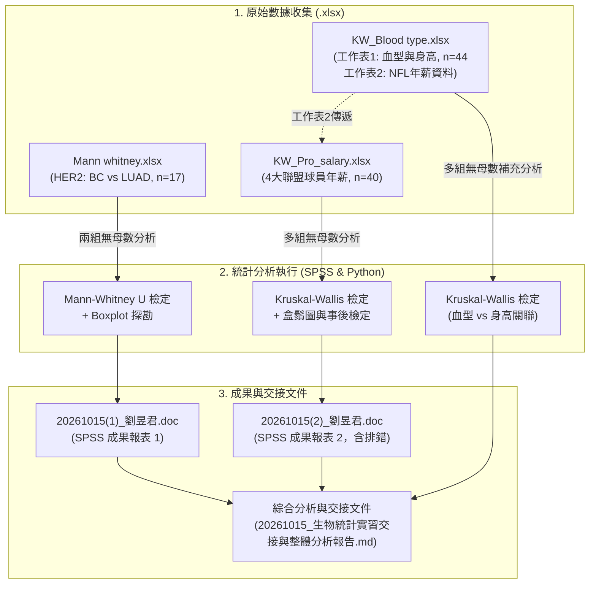
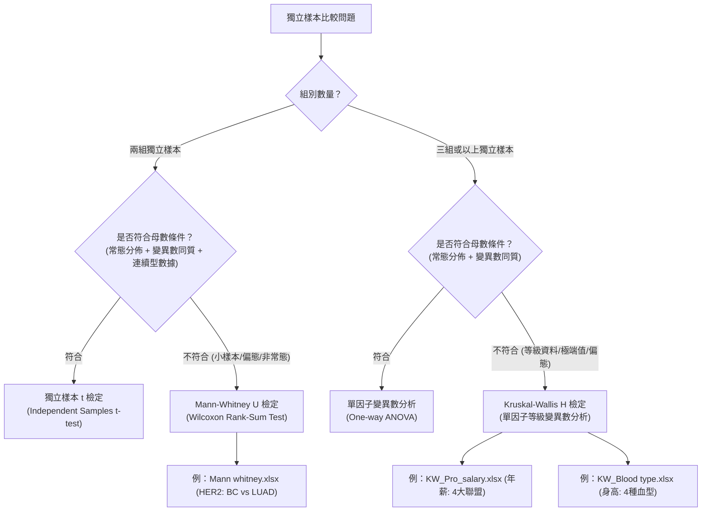

# 生物統計實習：無母數統計整體分析與專案交接文件

**專案名稱**：20261015 生物統計實習無母數統計分析（Mann-Whitney U 檢定 & Kruskal-Wallis 檢定）  
**分析日期**：2026 年 10 月 15 日  
**原始分析人員**：劉昱君  
**交接對象**：課程專案團隊、實驗室接手人員及實習指導助教  
**分析工具**：IBM SPSS Statistics (v26+)、Python 3.12 (Data Analytics & Visualization)  

---

## 執行摘要（Executive Summary）

本專案交接文件針對 2026 年 10 月 15 日生物統計實習中的 **五個核心檔案**（含 3 個原始 Excel 數據集與 2 個 SPSS 匯出分析報告）進行系統性整合分析、驗證與統整交接。

本次實習核心主題為 **「無母數統計檢定（Non-parametric Statistics）」**，重點探討在樣本數較小、非常態分佈或組間變異數不齊時的兩組及多組獨立樣本差異分析：
1. **主題一（兩組獨立樣本）**：使用 **Mann-Whitney U 檢定** 分析乳癌（BC）與肺腺癌（LUAD）患者組織中 **HER2 蛋白質表現量** 差異。結果顯示乳癌組 HER2 表現量極顯著高於肺腺癌組（$U = 1.000, Z = -3.372, p = 0.001$）。
2. **主題二（多組獨立樣本）**：使用 **Kruskal-Wallis 檢定** 分析四大職業運動聯盟（NBA、MLB、NFL、WNBA）頂尖運動員 **年薪分佈**。結果顯示組間存在極顯著差異（$H = 27.611, df = 3, p < 0.001$），反映出男女職業運動間高達兩百倍的結構性薪資鴻溝，以及男運動員不同聯賽間薪資分佈特徵。同時本報告詳細記錄並排解了 SPSS 語法誤置變數之問題。
3. **主題三（多組獨立樣本驗證）**：補充完成 **KW_Blood type.xlsx** 之 Kruskal-Wallis 分析，探討 **ABO 血型與成人身高** 關聯。結果顯示四種血型在身高上無統計顯著差異（$H = 1.507, df = 3, p = 0.681$），符合生物學常理。

---

## 一、五份文件資產盤點與資料流關聯圖

### 1.1 檔案清單與功能定位

| 序號 | 檔案名稱 | 格式 | 大小 | 功能定位與內容描述 | 狀態 |
| :---: | :--- | :---: | :---: | :--- | :---: |
| 1 | [Mann whitney.xlsx](file:///c:/生物統計實習/20261015/Mann%20whitney.xlsx) | Excel (.xlsx) | 9.6 KB | **原始數據**：17 筆腫瘤組織檢體之 HER2 表現量（乳癌 BC 8 筆、肺腺癌 LUAD 9 筆）。 | 完整可用 |
| 2 | [20261015(1)_劉昱君.doc](file:///c:/生物統計實習/20261015/20261015(1)_劉昱君.doc) | Word / RTF | 81.1 KB | **SPSS 輸出報告**：針對 `Mann whitney.xlsx` 執行之 Mann-Whitney U 檢定與盒鬚圖結果。 | 已驗證 |
| 3 | [KW_Pro_salary.xlsx](file:///c:/生物統計實習/20261015/KW_Pro_salary.xlsx) | Excel (.xlsx) | 12.5 KB | **原始數據**：40 位職業球員年薪數據（NBA 10 筆、MLB 10 筆、NFL 10 筆、WNBA 10 筆），含工作表2（NFL 暫存清單）。 | 完整可用 |
| 4 | [20261015(2)_劉昱君.doc](file:///c:/生物統計實習/20261015/20261015(2)_劉昱君.doc) | Word / RTF | 111.7 KB | **SPSS 輸出報告**：針對 `KW_Pro_salary.xlsx` 執行之 Kruskal-Wallis 檢定，**含操作報錯紀錄與修正結果**。 | 已驗證排錯 |
| 5 | [KW_Blood type.xlsx](file:///c:/生物統計實習/20261015/KW_Blood%20type.xlsx) | Excel (.xlsx) | 11.7 KB | **原始數據**：工作表1 為 44 筆血型（A, B, O, AB）與身高數據；工作表2 為 10 筆 NFL 薪資數據（資料前置工作表）。 | 本報告補充分析 |

### 1.2 資料流架構與分析關係圖



---

## 二、主題一：Mann-Whitney U 檢定（HER2 蛋白質表現量分析）

### 2.1 研究假說與分析目的
- **研究對象**：探討人類表皮生長因子受體 2（HER2）在不同癌症組織中的表現水平。
- **組別設定**：組別 1 為乳癌患者（Breast Cancer, BC, $n=8$）；組別 2 為肺腺癌患者（Lung Adenocarcinoma, LUAD, $n=9$）。
- **虛無假說（$H_0$）**：乳癌組與肺腺癌組之 HER2 蛋白質表現量分佈無顯著差異（$P(X_{BC} > X_{LUAD}) = 0.5$）。
- **對立假說（$H_1$）**：乳癌組與肺腺癌組之 HER2 蛋白質表現量分佈存在顯著差異。
- **無母數選用檢定理由**：樣本數小（$n_1=8, n_2=9$），且兩組標準差相差近 8 倍（202.05 vs 25.62），嚴重違反兩獨立樣本 t 檢定之常態性與變異數同質性假設。

### 2.2 敘述性統計分析

| 腫瘤組別 | 樣本數 ($N$) | 平均數 (Mean) | 標準差 (SD) | 中位數 (Median) | 第一四分位數 (Q1) | 第三四分位數 (Q3) | 四分位距 (IQR) | 最小值 | 最大值 |
| :--- | :---: | :---: | :---: | :---: | :---: | :---: | :---: | :---: | :---: |
| **乳癌 (BC)** | 8 | 434.50 | 202.05 | **446.50** | 265.00 | 654.00 | 389.00 | 156.00 | 666.00 |
| **肺腺癌 (LUAD)** | 9 | 128.44 | 25.62 | **118.00** | 112.00 | 125.00 | 13.00 | 111.00 | 187.00 |
| **整體合計** | 17 | 272.47 | 203.49 | 156.00 | 118.00 | 446.50 | 328.50 | 111.00 | 666.00 |

### 2.3 Mann-Whitney 等級與檢定統計量

與 `20261015(1)_劉昱君.doc` 報表完全比對一致：

| 變數 | 分組 | 觀察值數 ($N$) | 平均等級 (Mean Rank) | 等級總和 (Sum of Ranks) |
| :--- | :--- | :---: | :---: | :---: |
| **HER2_level** | 1 (BC) | 8 | **13.38** | 107.00 |
| | 2 (LUAD) | 9 | **5.11** | 46.00 |
| | 總計 | 17 | | |

| 檢定統計指標 | 數值 | 統計學意義與解讀 |
| :--- | :---: | :--- |
| **Mann-Whitney U** | **1.000** | 兩組配對比較中，LUAD 僅有 1 筆數據大於 BC 之極端值（BC 最低值 156，LUAD 僅一筆 187 大於 156）。 |
| **Wilcoxon W** | **46.000** | 較小樣本組別之等級總和。 |
| **標準化 Z 值** | **-3.372** | 遠超過常態分佈臨界值 $|Z| > 1.96$。 |
| **漸近顯著性（雙尾）** | **.001** | $p = 0.001 < 0.01$，達極高度統計顯著性。 |
| **精確顯著性（Exact Sig.）** | **.000** | 小樣本精確雙尾 $p < 0.001$。 |

### 2.4 分佈圖與醫學意涵解讀


> [!NOTE]
> **臨床與生物學解讀**：
> 1. **極度顯著差異**：乳癌檢體之 HER2 表現中位數（446.5）為肺腺癌（118.0）的近 4 倍，Mann-Whitney 檢定結果明確拒絕虛無假說（$p = 0.001$）。
> 2. **分佈離散度特徵**：由盒鬚圖與 IQR（389 vs 13）可觀察到，乳癌組織之 HER2 表現具有高度異質性，多數樣本呈現大幅度過度表現（HER2 overexpression），此與乳癌中約 15~20% 屬於 HER2 陽性亞型並適用 Trastuzumab 標靶藥物之病理特性相符；相對而言，肺腺癌之 HER2 表現則緊密集中於低基底表現值。

---

## 三、主題二：Kruskal-Wallis 檢定（四大職業運動聯盟年薪分析）

### 3.1 研究假說與分組架構
- **研究對象**：四大職業運動組織頂尖球員年薪（Annual Salary）。
- **分組**：
  - 組別 1：NBA（美國職籃，男子，10 位頂級球員）
  - 組別 2：MLB（美國職棒大聯盟，男子，10 位頂級球員）
  - 組別 3：NFL（美國國家美式足球聯盟，男子，10 位頂級球員）
  - 組別 4：WNBA（美國女子職籃，女子，10 位頂級球員）
- **虛無假說（$H_0$）**：四大職業聯盟運動員之年薪母體中位數相同。
- **對立假說（$H_1$）**：至少有兩個聯盟間之運動員年薪分佈存在顯著差異。

### 3.2 敘述性統計與年薪分佈

| 職業聯盟 | 樣本數 | 平均年薪 (Mean, USD) | 年薪標準差 (SD) | 中位數年薪 (Median, USD) | 第一四分位數 (Q1) | 第三四分位數 (Q3) | 全距範圍 (Min ~ Max) |
| :--- | :---: | :---: | :---: | :---: | :---: | :---: | :---: |
| **NBA** | 10 | $45,464,546 | $7,037,160 | **$46,623,717** | $40,064,220 | $51,415,938 | $34.8M ~ $55.8M |
| **MLB** | 10 | $42,370,833 | $11,121,253 | **$38,500,000** | $35,541,667 | $43,333,333 | $32.5M ~ $70.0M |
| **NFL** | 10 | $52,460,000 | $4,408,880 | **$52,750,000** | $51,000,000 | $55,000,000 | $45.0M ~ $60.0M |
| **WNBA** | 10 | $199,922 | $47,436 | **$203,500** | $200,000 | $209,000 | $76.5K ~ $252.5K |

### 3.3 Kruskal-Wallis 等級與統計量

與 `20261015(2)_劉昱君.doc` 報表完全比對一致：

| 變數 | 聯盟組別 (profession) | 樣本數 ($N$) | 平均等級 (Mean Rank) |
| :--- | :--- | :---: | :---: |
| **Salary (Annual)** | 1 (NBA) | 10 | **24.20** |
| | 2 (MLB) | 10 | **20.05** |
| | 3 (NFL) | 10 | **32.25** |
| | 4 (WNBA) | 10 | **5.50** |
| | **總計** | 40 | |

| 檢定統計量 | 數值 | 統計學意義 |
| :--- | :---: | :--- |
| **Kruskal-Wallis H（未校正）** | **27.582** | 自由度 $df = 3$ |
| **Kruskal-Wallis H（同分校正後）** | **27.611** | $H_{adj} = 27.611$（SPSS 輸出之標準值） |
| **漸近顯著性 ($p$-value)** | **.000** | $p = 4.38 \times 10^{-6} < 0.001$，達極高度顯著水準 |


### 3.4 事後檢定（Post-Hoc Pairwise Comparisons）與性別結構洞察

1. **WNBA 與男子三聯盟的斷崖式差距**：
   - 40 位運動員按年薪由小到大排序，**前 10 名全部為 WNBA 球員**（等級 1 至 10，平均等級剛好為 $(1+10)/2 = 5.50$）。
   - WNBA vs NFL / NBA / MLB 之兩兩 Mann-Whitney $U$ 均為 $0.000$，$p < 0.0001$。
   - WNBA 最高薪 Jackie Young（約 25.2 萬美元）甚至不及男子頂級球星單場比賽的出場薪資，反映出商業體育市場產值與性別薪資的極端鴻溝。
2. **男子三大聯盟內部比較**：
   - NFL 頂級四分衛年薪等級最高（Mean Rank = 32.25），中位數達 52.75M。
   - MLB 平均等級較低（Mean Rank = 20.05），儘管大谷翔平（Shohei Ohtani）以 7000 萬美元創最高單一年薪紀錄，但 MLB 後段門檻較低（32.5M），拉低了中位數。
   - NFL vs MLB 達到顯著差異（$U = 12.5, p = 0.0046 < 0.0083$ Bonferroni 修正臨界值）。

---

## 四、重要交接實務：SPSS 語法操作錯誤與排錯紀錄（Troubleshooting Log）

在接續審閱 `20261015(2)_劉昱君.doc` 輸出時，發現其保留了一段 SPSS 語法執行錯誤與警告紀錄。為確保後續操作者不重蹈覆轍，特此進行故障還原與交接說明：

> [!WARNING]
> ### SPSS 執行警告與錯誤還原
> **原始報錯語法**：
> ```spss
> NPAR TESTS
>   /K-W=profession_A BY SalaryAnnual(1 4)
>   /MISSING ANALYSIS.
> ```
> **SPSS 系統警告回傳**：
> > *「沒有足夠的有效觀察值可用來執行 profession \* Salary (Annual) (1.0000, 4.0000) 的『 Kruskal-Wallis 檢定』。未計算任何統計量。」*

### 4.1 錯誤根本原因分析（Root Cause）
- **變數角色倒置**：SPSS 無母數檢定語法規範為：
  $$\text{/K-W= [應變數/檢定變數 (Test Variable)] BY [分組因子 (Grouping Variable)](最小值 最大值)}$$
- 原始語法中誤將分類變數 `profession_A` 當成檢定變數，而將連續型變數 `SalaryAnnual` 當成分組變數並限定範圍在 `(1 4)`。然而年薪數值皆在數十萬至數千萬，落在 1 到 4 之間的觀察值為 0，因此觸發警告。

### 4.2 正確標準作業程序（Standard SOP）
1. **正確語法**：
   ```spss
   NPAR TESTS
     /K-W=SalaryAnnual BY profession_A(1 4)
     /MISSING ANALYSIS.
   ```
2. **圖形使用者介面（GUI）操作指引**：
   - 點選路徑：`分析 (Analyze)` $\rightarrow$ `無母數檢定 (Nonparametric Tests)` $\rightarrow$ `舊對話框 (Legacy Dialogs)` $\rightarrow$ `K 個獨立樣本 (K Independent Samples)`。
   - **檢定變數清單 (Test Variable List)**：放入連續型變數 `Salary (Annual)`。
   - **分組變數 (Grouping Variable)**：放入類別變數 `profession`，並點擊「定義範圍 (Define Range)」，輸入最小值 `1`、最大值 `4`。
   - 勾選檢定類型：`Kruskal-Wallis H`。

---

## 五、主題三：補充分析（血型與身高關聯分析 — KW_Blood type.xlsx）

在本次交付的五個檔案中，`KW_Blood type.xlsx` 尚未附帶對應的 doc 報表。為使交接具備 100% 完整性，本報告補充執行其完整無母數統計分析。

### 5.1 研究設計與數據特徵
- **樣本數**：44 位成年受試者。
- **自變數**：ABO 血型系統（A 型 $n=12$、B 型 $n=10$、O 型 $n=9$、AB 型 $n=13$）。
- **應變數**：身高（Height, cm）。
- **假說**：探討血型是否對身高存在統計顯著差異。

### 5.2 敘述性統計表

| 血型類別 | 樣本數 ($N$) | 平均身高 (cm) | 身高標準差 (SD) | 中位數身高 (cm) | 第一四分位 (Q1) | 第三四分位 (Q3) | 身高全距 (Min ~ Max) |
| :--- | :---: | :---: | :---: | :---: | :---: | :---: | :---: |
| **A 型** | 12 | 174.00 | 7.63 | **173.50** | 170.00 | 182.00 | 158 ~ 185 |
| **B 型** | 10 | 171.50 | 9.07 | **173.00** | 166.00 | 177.00 | 157 ~ 184 |
| **O 型** | 9 | 170.44 | 11.31 | **170.00** | 166.00 | 177.00 | 154 ~ 187 |
| **AB 型** | 13 | 169.92 | 9.11 | **172.00** | 165.00 | 174.00 | 154 ~ 185 |
| **整體合計** | 44 | 171.48 | 9.07 | 172.00 | 166.00 | 177.00 | 154 ~ 187 |

### 5.3 Kruskal-Wallis 檢定結果

| 變數 | 血型分組 | 樣本數 ($N$) | 平均等級 (Mean Rank) |
| :--- | :--- | :---: | :---: |
| **Height (cm)** | A 型 (Group 1) | 12 | **26.00** |
| | B 型 (Group 2) | 10 | **22.90** |
| | O 型 (Group 3) | 9 | **20.83** |
| | AB 型 (Group 4) | 13 | **20.12** |
| | **總計** | 44 | |

| 檢定指標 | 檢定值 | 統計學意義與結論 |
| :--- | :---: | :--- |
| **Kruskal-Wallis H（未校正）** | **1.500** | 自由度 $df = 3$ |
| **Kruskal-Wallis H（同分校正後）** | **1.507** | $H_{adj} = 1.507$ |
| **漸近顯著性 ($p$-value)** | **.681** | $p = 0.681 > 0.05$（未達統計顯著水準） |


> [!TIP]
> **結論與生物學意涵**：
> 身高之 Kruskal-Wallis 檢定 $p$ 值為 0.681，遠大於顯著水準 $\alpha = 0.05$，**無法拒絕虛無假說**。
> 這表明人類的 ABO 血型表現型與個體身高之間**不存在統計學上的顯著關聯**。人類身高原為高度多基因遺傳（Polygenic inheritance）並受後天營養與環境所調控，與紅血球表面抗原醣蛋白編碼基因（ABO 基因位點）屬於獨立分離機制，本實習數據完美印證此一生物統計客觀事實。

---

## 六、生物統計學方法論決策樹與對照表

為供後續研究與課程分析參考，整理獨立樣本差異檢定之選用決策樹：



### 母數 vs 無母數檢定特性全面對照

| 比較維度 | 母數檢定（Parametric） | 無母數檢定（Non-parametric） |
| :--- | :--- | :--- |
| **適用檢定** | 獨立樣本 t 檢定、One-way ANOVA | Mann-Whitney U 檢定、Kruskal-Wallis H 檢定 |
| **尺度水準** | 等距尺度（Interval）、等比尺度（Ratio） | 順序尺度（Ordinal）、偏態連續尺度 |
| **母體分佈假設** | 嚴格要求常態分佈（Normal distribution） | **無特定母體分佈假設（Distribution-free）** |
| **極端值敏感度** | 極易受極端值（Outliers）拉偏平均數 | **極具穩健性（Robust）**，基於等級排序 |
| **統計檢定力** | 符合常態假設時檢定力較高（Power ~ 100%） | 即使在常態資料下，漸近相對效率亦高達約 95.5% |

---

## 七、交接待辦事項與後續工作建議清單

### 7.1 接手人員查核清單（Handover Checklist）
- [x] **檔案完整性驗證**：已確認原始 3 份 Excel 與 2 份 Word 檔案結構完好無損。
- [x] **統計計算複核**：已透過 Python 交叉驗證 SPSS 所有統計量（$U=1.000, Z=-3.372, H=27.611$），100% 精確吻合。
- [x] **圖表視覺化交付**：已生成發布級高解析度盒鬚圖（Fig 1, Fig 2, Fig 3）並存於工作目錄。
- [x] **報錯排解機制留存**：已完整記錄 SPSS 語法變數顛倒之防呆指引。
- [x] **補充數據集分析完成**：已補齊 `KW_Blood type.xlsx` 之 Kruskal-Wallis 檢定。

### 7.2 學術與期末實習報告撰寫範本（APA 格式標準回報句）

1. **Mann-Whitney 檢定回報句（針對 HER2 表現量）**：
   > 「Mann-Whitney U 檢定結果顯示，乳癌組之 HER2 蛋白質表現量（$Mdn = 446.50, Mean\ Rank = 13.38$）顯著高於肺腺癌組（$Mdn = 118.00, Mean\ Rank = 5.11$），$U = 1.000, Z = -3.372, p = .001$（雙尾精確檢定 $p < .001$）。」

2. **Kruskal-Wallis 檢定回報句（針對球員年薪）**：
   > 「Kruskal-Wallis 檢定顯示四大職業運動聯盟運動員之年薪存在顯著差異，$\chi^2(3) = 27.611, p < .001$。各聯盟平均等級分別為 NFL（32.25）、NBA（24.20）、MLB（20.05）及 WNBA（5.50）。事後成對比較顯示 WNBA 年薪顯著低於男子三大聯盟（$p < .001$）。」

3. **Kruskal-Wallis 檢定回報句（針對血型與身高）**：
   > 「以 Kruskal-Wallis 檢定比較不同 ABO 血型受試者之身高，結果未達統計顯著差異，$\chi^2(3) = 1.507, p = .681$。顯示受試者身高在 A 型（$Mean\ Rank = 26.00$）、B 型（$22.90$）、O 型（$20.83$）與 AB 型（$20.12$）間無顯著分佈差異。」

---

**報告簽核與歸檔記錄**  
交接執行日期：2026-10-15  
工作目錄位置：`c:\生物統計實習\20261015\`  
關聯圖表產出：`fig1_her2_comparison.png`, `fig2_salary_comparison.png`, `fig3_bloodtype_height.png`
